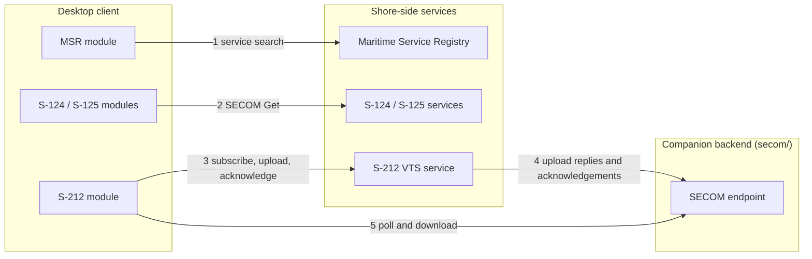
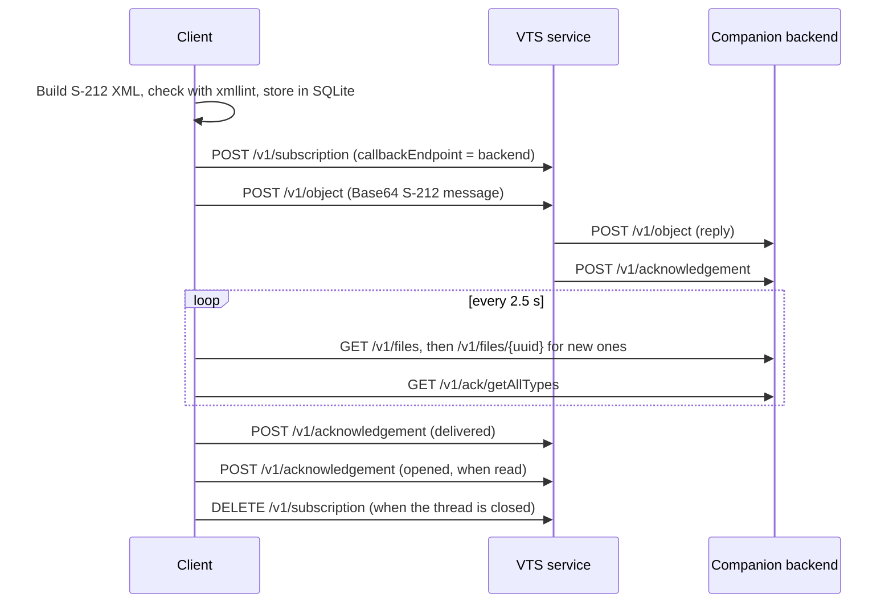

# Architecture

`s100-sampler` is a desktop client (C++17, Qt 5) plus a companion backend (Java 17, Spring Boot). The client discovers SECOM services, downloads and parses S-124 and S-125 datasets, and exchanges S-212 traffic-clearance messages. The backend receives the messages that a VTS service sends back to the ship.

The numbered flows match Figure 2 of the paper.

## Source layout

| Folder (`include/` and `src/`) | Contents |
| --- | --- |
| `S100/` | Shared base classes: `S100DataLayer` (download, backup, scan, store), `S100FeatureWrapper`, `S100DataDisplay`, `S100Service` |
| `S124/` | Navigational warnings: `NAVWARNDataLayer` and the S-124 data classes (`NAVWARNPreamble`, `NAVWARNPart`, `NAVWARNAreaAffected`, `References`) |
| `S125/` | Aids to Navigation: `ATONDataLayer`, `ATONMember`, `ATONWrapper` |
| `S212/` | VTS traffic clearance: `VTSDataLayer` (SECOM calls), `VTSMessageWrapper` (builds S-212 XML), `VTSMessageRepository` (SQLite), message and widget classes |
| `parser/` | XML parsers on pugixml: `S100Parser` (shared geometry and GML), `NWParser`, `ATONParser`, `VTSParser` |
| `MSR/` | Registry search, the service database, and the MSR dialog |
| `basicAttributes/`, `S100_CodeLists/`, `enumerations/` | S-100 types (dates, geometry, positions) and code lists |
| `mainUI/` | Main window, NW/AtoN dialog (`datadialog`), VTS dialog, notifications |
| `Curler.cpp` | All HTTP(S) requests, on libcurl |
| `Resources.hpp` | Loads `config.toml` |

## How a product module is built

S-124 and S-125 follow the same layers:

| Layer | S-124 | S-125 |
| --- | --- | --- |
| Data classes, following the product specification | `S124/NAVWARN*` | `S125/ATONMember` |
| Parser | `parser/NWParser` | `parser/ATONParser` |
| Data layer: download, backup, scan, SQLite | `NAVWARNDataLayer` | `ATONDataLayer` |
| Display: a searchable tree in `datadialog` | via `S100DataDisplay` | via `S100DataDisplay` |

`S100DataLayer` does the shared work. A product's data layer implements `scanAndLoad()`, which parses the files in its folder, and `clearDatabase()`.

Supporting a revised edition of a product mostly means changing that product's data classes and parser. The modules still share the network code, configuration, geometry parsing and main window, so a change can reach those too.

## S-124 and S-125: from service to dialog

1. In the MSR dialog the user activates a service instance. Its data-product type decides whether it goes to the S-124 or S-125 module.
2. **Manual NW update** (or **Manual AtoN update**) calls `fullRefresh()`. With services selected, it:
   1. moves the current files to `backup/`;
   2. clears the database;
   3. calls SECOM Get (`/v1/object`) on each active service, using the client certificate;
   4. decodes the Base64 payloads and saves each dataset as an XML file named after its identifier;
   5. calls `scanAndLoad()`.
3. With no services selected, `fullRefresh()` only clears the database and calls `scanAndLoad()` on the existing files.
4. `scanAndLoad()` parses each file not yet recorded in the database and records its identifier and file name. The parsed objects are kept in memory for the dialog.

## S-212: a traffic-clearance exchange

The client groups messages into threads in the VTS dialog. The backend stores replies in `secom/uploads/` and their records in H2; see [SECOM backend](SECOM-BACKEND.md#routes) for all routes.

## Removed chart integration

The original NoviaECS system drew S-124 and S-125 on a chart with a commercial SDK (Teledyne SevenCs Nautilus). The SDK and the files that depended on it most (overlays, own-ship and NMEA handling) were removed; see [External requirements](EXTERNAL-REQUIREMENTS.md#chart-engine-licence-and-charts). The data classes still hold positions and geometry, so a chart engine could be attached in the main window, where the chart widget used to be.

### Commented-out chart code

In the main window, the original developer commented out the SDK calls instead of deleting them. About 90 such lines remain in `src/mainUI/MainWindow.cpp` and `include/mainUI/MainWindow.hpp`. They are kept on purpose, because they show where the chart engine was connected.

- **They do not compile or run.** The functions that contained them still exist, mostly with empty bodies, so the related menu items do nothing.
- **Do not uncomment them.** They need the Nautilus SDK, which is not included and requires a commercial licence.
- **Use them as a map** if you connect another chart engine. Each block marks one connection point:

| Function in `MainWindow.cpp` | What the commented code did |
| --- | --- |
| `initializeUI()`, `initializeChart()` | Created and set up the chart widget |
| `initializeOverlays()` | Added route and scale-bar overlays |
| `initializeShipSystems()`, `setupShipOverlay()` | Started NMEA input and drew the own ship |
| `loadChart()`, `loadGeneralCharts()` and the other `load…()` functions, `clearCharts()` | Loaded and removed chart datasets from the folders in `[charts]` |
| `changePainterMode()`, `changeLoadingStrategy()`, `changeAsyncMode()`, `changeAntialiasingMode()`, `changePreviewMode()` | Chart rendering settings in the **Settings** menu |
| `changeColourPalette()`, `showDisplayCategoryMenu()` | Day/night palette and chart display categories |
| `showContextMenu()`, `onOption1()`, `pointNorth()`, `lockToShip()`, `moveToShip()`, `applyScale()`, `jumpToCoordinates()` | Chart navigation: context menu, north-up, centring on the ship, zoom, and jumping to a warning's position |
| `scanNWFolder()`, `scanATONFolder()`, `fullNWReload()`, `fullATONReload()` | Drew the S-124 and S-125 overlays after a data update |

In `MainWindow.hpp`, the commented members are the chart widget, its overlays and the chart library.
